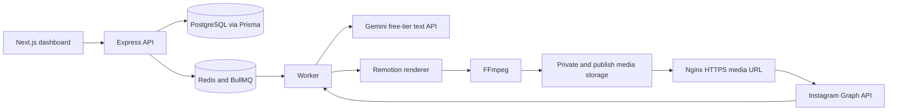

# AI Social Media Manager — Technical Handoff

**Document purpose:** implementation brief for the first usable version of a reusable, multi-brand system that creates short educational Instagram Reels.  
**Status:** this repository contains a working local prototype. The document distinguishes what currently runs from what still needs implementation or account verification.
**Last context review:** 11 November 2026.

## 1. Status and decision labels

This handoff uses three labels:

- **Confirmed** — stated as a project decision in the available conversation.
- **Proposed** — a concrete implementation contract for the developer to use unless the owner changes it.
- **Verify before release** — account, brand, infrastructure, or platform details not established by the conversation.

| Area | Current status |
|---|---|
| Product | Confirmed: reusable social content manager, with LearnOps as the first brand |
| Video proof of concept | User-confirmed: one 12-second vertical Remotion video was generated and watched |
| Test 2 | Three topic-specific fixtures and a render command exist; actual MP4 output still needs to be rendered and inspected |
| Gemini | `gemini-3.8-flash` is configured for structured text generation on the free tier; owner account quota and access still need verification |
| Instagram | Instagram Graph API selected; account eligibility, app access, permissions, and publishing test remain unverified |
| Automation | A local daily scheduler and BullMQ generation job exist; the daily path currently drafts a script and does not automatically render or publish it |
| Runtime | Node 24 is the project runtime; `.nvmrc` and the root `engines` field record it |
| Local build | Root workspace build succeeds on Node 24; Test 2 renders have not yet been run and inspected |

The first video is a successful proof of concept based on the owner’s confirmation that it rendered and was watched. The prior conversation did not independently inspect its file or render logs, so exact file path, resolution, frame rate, and encoding are not asserted here. The first video did **not** prove Gemini generation, reusable topic-specific animation, Instagram publishing, or scheduling.

## 2. Purpose and first release

Build a dashboard and backend that can prepare, render, review, and ultimately publish short educational Reels. LearnOps is the first configured brand. The underlying content, brand styling, knowledge, and social account must be data-driven so another brand can be added without changing the renderer.

### Confirmed content direction

- Short educational content about Linux and DevOps, including Docker and CI/CD.
- Visual storytelling with animated diagrams, folder structures, terminal demonstrations, kinetic typography, and smooth transitions.
- Initial visual direction follows the reference and first test: dark scenes, orange and white emphasis, with occasional light scenes.
- The exact LearnOps logo, font files, color values, tone guide, and approved claims must come from LearnOps source material; do not invent them.
- A central, provider-independent knowledge base should hold approved LearnOps facts and brand material. Gemini receives only the relevant approved context for a generation request. GPT conversation history is not automatically available to Gemini.

**Audience working assumption:** beginner and early-stage learners studying Linux, DevOps, and related tools. Confirm the precise audience profile, language, and tone against the LearnOps brand brief before production content is generated.

## 3. Free-only budget policy

This is a hard product constraint:

- Use Gemini only for text and structured script/scene data, and only through an eligible free-tier API project/model.
- Do not use the paid Gemini tier, paid OpenAI API, paid text-to-video or image-generation API, or paid voice/video service.
- Remotion, React/SVG/CSS, local assets, and FFmpeg create the video. Gemini does not generate the video.
- Do not enable automatic paid upgrades or billing for the Gemini integration. If free quota is exhausted, stop or defer the affected job until quota is available. Never silently switch to a paid provider or paid tier.
- Use no paid workflow automation service. BullMQ and Redis are the intended scheduler/queue.
- No hosting or operating cost is estimated in this document. The prior plan names an Ubuntu VPS; its capacity and current availability must be checked.

Google’s published free-tier model access and limits vary by model and project, and its current pricing page states that free-tier content may be used to improve Google products. Check the selected account’s actual quota in AI Studio before integration; send only approved, non-secret content and review current Google terms for the intended data. Do not put secrets, credentials, private user data, or unapproved confidential material in prompts.

## 4. Confirmed technology choices

| Layer | Selected technology | Role |
|---|---|---|
| Dashboard | Next.js + Tailwind CSS | Brand/content administration, previews, job status, and publishing controls |
| Backend API | Express + TypeScript | Authenticated API, validation, orchestration, and integrations |
| Text generation | Gemini API, free tier only | Topic, hook, script, scene JSON, caption, and hashtags |
| Animation | Remotion + React + TypeScript | Deterministic animated scenes from validated scene data |
| Video processing | Remotion H.264 output; separate FFmpeg checks are planned | Current render saves MP4 and basic metadata; normalization/inspection stage is not implemented |
| Database | PostgreSQL + Prisma | Brands, knowledge, topics, reels, jobs, assets, and publishing records |
| Queue/scheduler | Redis + BullMQ | Asynchronous generation/render/publish jobs and daily scheduling |
| Publishing | Instagram Graph API / Instagram Platform | Publish an approved Reel to an eligible professional account |
| Runtime and edge | Docker on Ubuntu VPS + Nginx | Isolated services, HTTPS, reverse proxy, and temporary public media delivery |
| File storage | VPS-mounted storage is the proposed initial option | Private working files and final MP4 assets; capacity and retention need configuration |

Do not assume a repository layout, package manager, domain, VPS size, exact library version, or credential. Inspect the eventual project and choose compatible supported versions during implementation.

## 5. Proposed architecture and pipeline

Target architecture: the browser talks to the Express API, PostgreSQL stores product data, and Redis/BullMQ runs long operations. In this checkout, Gemini output is rendered by Remotion directly to H.264 MP4 and stored locally; a separate FFmpeg validation/normalization step and public Nginx media hosting are not set up yet. The daily scheduler drafts scripts; it does not automatically render or publish them.



### End-to-end job

1. A user creates or selects a topic, or the daily scheduler chooses an eligible topic for a brand.
2. The API enqueues a generation job with a stable idempotency key.
3. The worker builds a prompt from the brand profile and only the relevant approved knowledge documents.
4. Gemini returns structured JSON. The backend validates the JSON against a versioned schema and validates each scene against an allowlist of renderer components. Model output is data, never executable code.
5. The system stores the script and scene list. The owner can inspect and edit it in the dashboard. **Whether approval is mandatory before rendering or publishing is an open product decision; keep an approval gate configurable and default to review during early rollout.**
6. Current code renders the topic-specific animation to H.264 MP4 with Remotion and records basic metadata. Add a separate FFmpeg validation/normalization step before production use.
7. The dashboard shows the preview and status. An authorized action or configured schedule starts publishing.
8. The worker exposes the final asset over HTTPS for Meta to fetch, creates a media container, polls processing status as required, and publishes it. It stores Meta identifiers and the final result.
9. The system records success/failure, cleans up temporary files according to the configured retention policy, and shows the result in the dashboard.

### Duration and video format

Duration is dynamic and selected for educational completeness:

- **15–18 seconds:** default for normal educational Reels and the required duration for all three Test 2 videos.
- **20–25 seconds:** topics that need additional explanation.
- **10–12 seconds:** quick tips or a single simple fact.
- The renderer derives total frames from scene timing. Do not force all topics to one fixed length or truncate a useful explanation to fit.

**Proposed initial render target:** vertical 9:16 MP4 at 1080 × 1920. Use a consistent frame rate configured for the renderer (30 fps is a reasonable proposed default). Confirm actual current Meta media constraints before publishing. H.264 video is a proposed baseline. Audio generation has not been selected; do not add a paid text-to-speech API. If audio is introduced, use only an owner-provided or properly licensed track and verify its codec/format separately.

## 6. Test 2 — required renderer validation

Before connecting Gemini or Instagram, reuse the existing Remotion renderer to produce three distinct educational videos from explicit scene data:

| Topic | Duration | Animation must explain the topic visually |
|---|---:|---|
| Linux: what is the `/etc` directory? | 15–18 seconds | Show a Linux configuration directory/tree and representative configuration files |
| Docker: what is a container? | 15–18 seconds | Show an isolated container running on a host, distinct from an image or virtual machine |
| DevOps: what is CI/CD? | 15–18 seconds | Animate a commit moving through build, test, and delivery/deployment stages |

Acceptance requires three playable MP4 files, each in the target vertical format and within the duration range, with visibly different topic-specific visual logic. Reusing a renderer and shared motion primitives is desired; changing only the title/text on one generic animation does not pass. Record output locations and measured media metadata when the test is run. This handoff does not claim Test 2 has been completed.

## 7. Content contract and scene safety

Use a versioned JSON contract between text generation and the renderer. A proposed response shape:

```json
{
  "schemaVersion": 1,
  "topic": "What does /etc store in Linux?",
  "hook": "Where does Linux keep system settings?",
  "durationSeconds": 16,
  "narrationText": null,
  "scenes": [
    {
      "kind": "folder_tree",
      "durationSeconds": 5,
      "headline": "System configuration",
      "items": ["/etc", "/etc/hosts", "/etc/ssh"]
    },
    {
      "kind": "terminal",
      "durationSeconds": 5,
      "command": "ls /etc",
      "explanation": "Lists configuration files"
    }
  ],
  "caption": "A quick look at /etc in Linux.",
  "hashtags": ["Linux", "DevOps", "LearnOps"]
}
```

This is illustrative; choose the final schema from the supported renderer components. Validate with a runtime schema library (for example, Zod) on the API boundary and again in the worker. Requirements:

- Enforce an allowlisted `kind` union such as `kinetic_type`, `folder_tree`, `terminal`, `diagram`, and `pipeline`.
- Bound text length, scene count, per-scene duration, total duration, and visual item counts.
- Reject unknown component kinds, arbitrary URLs, raw HTML, JavaScript, JSX, shell execution, or filesystem paths from Gemini.
- Escape user/model text when rendered. Keep theme, logo, fonts, and reusable component choices in brand configuration.
- Preserve the model name, prompt/schema version, and source knowledge document IDs with each generated reel for review and reproducibility.
- Do not let generated content assert LearnOps product capabilities unless they are supported by approved knowledge.

## 8. Data model proposal

Use UUID primary keys, UTC timestamps, Prisma migrations, and foreign keys. The following is a logical design proposal, not an assertion that these tables exist.

| Entity | Main data |
|---|---|
| `Brand` | ID, unique slug, display name, active/paused status, timezone, default duration policy, theme/profile reference |
| `BrandProfile` | Brand ID, audience, language, voice rules, content pillars, visual theme, logo/font asset references |
| `KnowledgeDocument` | Brand ID, title, source/reference, content, version, approval status, approved timestamp; only approved documents may enter prompts |
| `Topic` | Brand ID, title, category, brief, source, status, last-used date |
| `Reel` | Brand ID, Topic ID, structured script JSON, caption, target duration, schema/prompt/model versions, content status, planned publish time |
| `Scene` | Reel ID, sequence, allowlisted kind, duration frames, validated props JSON |
| `MediaAsset` | Reel ID, storage key/path, checksum, MIME type, bytes, dimensions, duration, render status, created/deleted timestamps |
| `SocialAccount` | Brand ID, platform, provider account ID, connection status, scopes, token expiry/reference; never store a raw access token in ordinary rows |
| `PublishAttempt` | Reel ID, account ID, attempt number, status, idempotency key, Meta container/media IDs, safe error details, timestamps |
| `JobRun` | Job type, BullMQ ID, business idempotency key, status, attempt counts, scheduled/start/end times, safe error summary |
| `AuditEvent` | Actor, action, entity reference, timestamp, minimal change metadata; exclude tokens and sensitive prompt data |

Important indexes/constraints:

- Unique `Brand.slug`.
- Unique job idempotency key.
- Unique (brand, platform, provider account ID) for a connected account.
- Index status and scheduled timestamps for queue/dashboard queries.
- Index brand + created time for reels, topics, and knowledge documents.
- Keep every brand-owned row scoped by `brandId`; the API must authorize brand access on every request.
- Store large binary media outside PostgreSQL. Store metadata and a storage key in PostgreSQL.
- Initially, keep working renders private on a mounted VPS volume. Publish URLs should be HTTPS, unguessable, and available to Meta only as long as needed. Do not expose directory listings. Confirm available disk, cleanup/retention, and backup location before launch.

## 9. Status model and idempotency

Keep content lifecycle status separate from queue execution status.

**Proposed Reel lifecycle:**

`DRAFT → SCRIPT_READY → READY_TO_RENDER → RENDERING → RENDERED → NEEDS_REVIEW → APPROVED → SCHEDULED → PUBLISHING → PUBLISHED`

Allow `FAILED` and `CANCELLED` terminal outcomes, with an explicit retry action returning an eligible stage to its queued state. If approval is not required, transition from `RENDERED` to `APPROVED` only when the configured brand policy permits automatic publishing.

**Proposed persisted job states:** `QUEUED`, `RUNNING`, `RETRY_WAIT`, `SUCCEEDED`, `FAILED_FINAL`, `CANCELLED`. BullMQ has its own runtime states; keep enough application state in PostgreSQL to explain and recover the workflow.

Reliability requirements:

- Enqueue one daily run per brand/local date using a unique key such as `daily:<brandId>:<YYYY-MM-DD>`. The timezone and publish time must be configured; they have not been specified yet.
- Accept an `Idempotency-Key` for generation and manual publish actions. Persist it before enqueueing.
- Set bounded attempts, exponential backoff with jitter, and a maximum retry age. Respect provider retry instructions where available.
- Retry transient network, rate-limit, and server errors. Do not loop on invalid schema, unsupported media, revoked permissions, or other permanent client errors.
- On Gemini quota exhaustion, defer/pause without switching to paid service.
- Publishing calls can time out after Meta has accepted a request. Persist container IDs and remote media IDs, reconcile current remote status before retrying, and never blindly repeat a publish call.
- Record attempt number, safe provider error code/message, and correlation ID. Redact access tokens and signed media URLs from logs.
- Provide dashboard actions to retry eligible failures, cancel queued work, and pause a brand/account.

## 10. Proposed API routes

Use a versioned JSON API under `/api/v1`. These routes are an implementation proposal, not previously deployed endpoints. Require dashboard authentication on management routes; scope every route to the authorized brand. Return a job ID for long-running work rather than holding the HTTP request open.

| Method and route | Purpose |
|---|---|
| `GET /health` | Minimal liveness check; no secrets or detailed infrastructure info |
| `GET /api/v1/brands` | List brands visible to the current user |
| `POST /api/v1/brands` | Create brand configuration |
| `GET /api/v1/brands/:brandId` / `PATCH ...` | Read/update profile, schedule, duration, and theme settings |
| `GET/POST /api/v1/brands/:brandId/knowledge` | List/import approved knowledge documents |
| `PATCH/DELETE /api/v1/brands/:brandId/knowledge/:documentId` | Edit, approve, archive, or remove a document |
| `GET/POST /api/v1/brands/:brandId/topics` | Manage topic pool |
| `POST /api/v1/brands/:brandId/topics/:topicId/generate` | Enqueue script generation; return job/reel ID |
| `GET /api/v1/brands/:brandId/reels` | Filter reels by lifecycle status and date |
| `GET/PATCH /api/v1/reels/:reelId` | Read or edit script, scene data, caption, and schedule |
| `POST /api/v1/reels/:reelId/render` | Enqueue render |
| `POST /api/v1/reels/:reelId/approve` | Record review decision if approval gate is enabled |
| `POST /api/v1/reels/:reelId/schedule` | Queue a publish time after validation and approval |
| `POST /api/v1/reels/:reelId/publish` | Request immediate publish after validation and approval |
| `POST /api/v1/reels/:reelId/retry` / `POST .../cancel` | Retry eligible work or cancel queued work |
| `GET /api/v1/jobs/:jobId` | Read persisted job status and safe failure detail |
| `GET /api/v1/brands/:brandId/integrations/instagram` | Read connection/eligibility status without returning secrets |
| `POST /api/v1/brands/:brandId/integrations/instagram/connect` | Begin provider-approved OAuth connection flow |
| `GET /api/v1/integrations/instagram/callback` | Validate OAuth state and finish connection |
| `DELETE /api/v1/brands/:brandId/integrations/instagram` | Disconnect/revoke stored credential reference |
| `POST /api/v1/integrations/instagram/webhook` | Optional webhook receiver if required by the chosen Meta login/API flow |

For every mutation, validate request bodies, enforce CSRF protection where cookie sessions are used, and apply rate limits. OAuth state must be random, short-lived, and single-use. Never return access tokens from an API route. Finalize the OAuth endpoints and permissions only after selecting and verifying the supported Meta login path.

## 11. Instagram publishing constraints and eligibility checks

Instagram Graph API is the chosen publishing direction, but it is **not yet confirmed that the account or developer app can publish**.

Before implementation/testing, verify in the owner’s Meta account and current Meta documentation:

1. The target Instagram account is an eligible Professional account (Business or Creator). Personal-account publishing is not assumed.
2. The chosen login path and its account/Page relationship requirements. Requirements differ by Instagram Login versus Facebook Login; do not hard-code a login type before checking the account.
3. The developer app has the exact publishing permissions/scopes and access level needed for the target account. Determine whether App Review, Advanced Access, business verification, or app roles are required for the intended use.
4. The access token can be issued, securely refreshed/replaced as required, and revoked. Do not assume a token never expires.
5. Any Page Publishing Authorization or account-specific restriction is resolved.
6. Meta can fetch the encoded MP4 from a publicly reachable HTTPS URL at publish time. The URL must serve the actual media with a suitable content type and must not require dashboard login.
7. The publishing workflow is implemented according to the current container processing/publishing flow: create container, wait/poll for readiness, then publish and persist returned IDs.
8. Check current media constraints and account publishing limit from the active Meta docs/API. Do not assume numeric limits from older guides.
9. Test with an owner-controlled account and a deliberately approved test Reel before enabling unattended publishing.

The common container-based flow and public-media requirement are documented in Meta’s [Instagram content-publishing guide](https://developers.facebook.com/docs/instagram-platform/content-publishing) and Meta’s [Instagram API collection](https://www.postman.com/meta/instagram/documentation/6yqw8pt/instagram-api). Confirm the latest supported endpoints, scopes, media requirements, review rules, and quotas when implementation begins because Meta can change these.

## 12. Environment configuration

Create a secret-free `.env.example` with names and descriptions only. Actual secret values belong in a protected deployment secret store or host environment and must never be committed.

| Variable | Purpose |
|---|---|
| `NODE_ENV` | Runtime mode |
| `API_PORT` | Express listen port |
| `APP_BASE_URL` | Canonical HTTPS dashboard/API base URL |
| `NEXT_PUBLIC_API_BASE_URL` | Browser-visible API base URL; contains no secret |
| `DATABASE_URL` | PostgreSQL connection string |
| `REDIS_URL` | Redis connection string, private to Docker network |
| `SESSION_SECRET` | Secret used for local token encryption; keep it private and stable while encrypted tokens exist |
| `API_ADMIN_TOKEN` | Production API bearer token; never expose it in browser JavaScript |
| `GEMINI_API_KEY` | Free-tier Gemini API key; backend only |
| `GEMINI_MODEL` | Model name selected after checking account free-tier access/quota |
| `GEMINI_MAX_REQUESTS_PER_DAY` | Local safety cap below verified quota |
| `REPO_CREDIT_URL` | Optional URL printed as an open-source credit on generated Reel end cards |
| `META_APP_ID` | Meta app identifier |
| `META_APP_SECRET` | Meta app secret; backend only |
| `META_GRAPH_API_VERSION` | Explicit supported API version after verification |
| `META_IG_USER_ID` | Optional account identifier, if needed by selected flow |
| `META_ACCESS_TOKEN` or secret reference | Temporary single-account bootstrap only; prefer encrypted token storage/secret manager per account |
| `PUBLIC_MEDIA_BASE_URL` | HTTPS origin from which Meta can fetch media |
| `MEDIA_STORAGE_DIR` | Mounted directory for private working/final assets |
| `MEDIA_RETENTION_DAYS` | Owner-selected cleanup/retention period |
| `SCHEDULER_TIMEZONE` | Brand schedule timezone, e.g. an IANA timezone after owner selection |
| `DAILY_PUBLISH_TIME` | Owner-selected local publish time |
| `WORKER_CONCURRENCY` | Bounded worker concurrency, sized to VPS resources |
| `MAX_RENDER_SECONDS` | Render timeout based on measured capacity |

The root `.env.example` supplies the current local variable names. In development, API routes allow requests without a token and return a warning header. Production API routes require `API_ADMIN_TOKEN`; the browser dashboard does not yet implement a secure login/token flow, so this checkout is not ready for public production deployment. Never use a `NEXT_PUBLIC_` variable for a credential. Keep PostgreSQL and Redis off the public network.

## 13. Security and operations

- Put the dashboard behind authentication. Use secure, HTTP-only, SameSite cookies or another established session mechanism; enforce CSRF protections for cookie-authenticated mutations.
- Enforce authorization at both API and data-access layers. A brand ID in the URL is not proof of access.
- Store only approved content in the Gemini context. Review Google’s current free-tier data-use terms and keep credentials and user personal data out of prompts.
- Store Meta tokens encrypted at rest or as secret references; restrict access to the publishing worker. Redact secrets, authorization headers, token query parameters, and private media URLs from logs.
- Validate every Gemini output and user edit. Renderer components must be a fixed, audited allowlist; never execute model-generated code.
- Run containers as non-root where practical, pin reviewed image/dependency versions, limit filesystem mounts, and keep database, Redis, worker, and admin ports private behind Docker/Nginx.
- Use TLS at Nginx. Apply request-size limits, rate limits, CORS allowlists, and security headers.
- Generate unguessable media paths, disable directory listing, and delete temporary public media after Meta has fetched it and retention policy allows.
- Maintain database and media backups; document where backups live, access controls, retention, and a restore procedure before production. No backup service or cost is assumed.
- Add structured logs and health checks without logging credentials or unnecessary user/content data. Alert the dashboard/operator on exhausted Gemini quota, expired Meta token, disk pressure, repeated render failure, and publish failure.
- The free tier is not a production availability guarantee. Keep a manual generate/render/publish path available if the daily job is paused.

## 14. Delivery phases and acceptance criteria

The first confirmed video exists as a proof of concept. The following phases describe remaining work; implementation status beyond that proof is not established.

| Phase | Work | Acceptance criteria |
|---|---|---|
| 0. PoC baseline | Preserve the first Remotion example and record its actual file metadata when available | Owner-confirmed video is noted as successful; exact technical metadata is filled only from inspecting the actual file |
| 1. Test 2 | Reuse renderer for Linux `/etc`, Docker containers, and DevOps CI/CD | Three playable 15–18-second vertical MP4s; each has a genuinely different topic-specific animation; metadata and output locations recorded |
| 2. Brand knowledge + Gemini text | Add initial brand/topic/knowledge data and a free-tier Gemini client; generate validated script JSON | Correct project/model quota confirmed; no paid billing path; generated JSON passes schema; no unsupported scene kinds or invented LearnOps claims |
| 3. Render integration | Drive Remotion from validated scene data and normalize with FFmpeg | Same input deterministically renders a valid MP4; duration and dimensions validated; failures persisted and retryable |
| 4. Dashboard + persistence | Implement Next.js dashboard, Express API, Prisma/PostgreSQL, Redis/BullMQ | Admin can configure brand, knowledge, topics, see job/reel state, preview content, and retry/cancel eligible jobs |
| 5. Meta eligibility + test publish | Connect an owner-controlled eligible account and implement current Meta publishing flow | Correct permissions/access verified; public HTTPS media fetch succeeds; one approved test Reel publishes once; remote IDs recorded; duplicate retry prevented |
| 6. Daily scheduler | Schedule one run per configured brand/local day; define approval/auto mode | Scheduler creates at most one daily job per brand/date; quota/auth/media failures pause safely; no duplicate post on retry |
| 7. Multi-brand readiness | Add a second brand through configuration and data only | Its profile, knowledge, theme, topics, account, and schedule remain isolated; no renderer code fork or cross-brand content leakage |

Do not begin production auto-publishing until the Meta account/app checks, quota behavior, review/approval policy, and retry/idempotency behavior have passed.

## 15. Decisions still needed or verification required

### Account/provider verification

- **Gemini quota/model:** select a text-capable model actually available on the owner’s free-tier project; inspect live RPM/TPM/RPD limits and daily volume fit in AI Studio; confirm the API key/project is not attached to paid billing. Limits and model availability can change.
- **Meta eligibility:** check Professional account type, selected login flow, app roles/access level, exact permissions, App Review/Advanced Access/business-verification needs, token lifecycle, and any account restrictions.
- **VPS capacity:** confirm CPU, RAM, disk, public IPv4/domain, TLS setup, outbound provider access, and whether Remotion/Chromium/FFmpeg can render within acceptable time.

### Product details not yet fixed

- Exact LearnOps audience, language, tone, pillars, content claims, logo/colors/fonts, and initial approved knowledge documents.
- Daily publish time and timezone.
- Whether every Reel requires human approval or whether a brand can opt into auto-publish.
- Whether captions/hashtags need edits, and how many topics to queue.
- Audio/narration requirements and rights to any music or sound assets.
- Media and knowledge retention periods, backup location, and storage capacity.
- Dashboard authentication method and which people may administer brands.
- Exact resolution/frame rate/codec after reviewing current Meta media rules and the intended account’s limits.

## 16. Explicitly out of scope for the first release

- Paid OpenAI API, paid Gemini tier, paid video/image-generation API, paid text-to-speech, or paid publishing/automation platform.
- Generative video footage. The renderer is code-driven Remotion animation using reusable visual components and approved local assets.
- Instagram comments, DMs, inbox management, engagement farming, analytics/insight reporting, ad buying, and moderation automation.
- Other social platforms until Instagram publishing works and the platform abstraction is intentionally extended.
- Multi-tenant public SaaS signup, billing, subscription management, or arbitrary third-party customer onboarding.
- Fine-tuning a model or transferring GPT memory automatically. Brand knowledge is curated, versioned data provided in Gemini requests.
- Arbitrary model-authored React, JavaScript, HTML, shell commands, or renderer components.
- Claims of zero operating cost: the free-only rule governs external APIs; the project has not established VPS, domain, storage, or operating costs.

## 17. Reference documentation to recheck during implementation

- Google: [Gemini API pricing and free-tier availability](https://ai.google.dev/gemini-api/docs/pricing)
- Google: [Gemini API rate limits and project quotas](https://ai.google.dev/gemini-api/docs/rate-limits)
- Google: [Gemini API billing and quota FAQ](https://ai.google.dev/gemini-api/docs/billing)
- Meta: [Instagram Platform content publishing](https://developers.facebook.com/docs/instagram-platform/content-publishing)
- Meta: [Instagram API collection](https://www.postman.com/meta/instagram/documentation/6yqw8pt/instagram-api)
- Remotion: [Official documentation](https://www.remotion.dev/docs/)
- Prisma: [Official documentation](https://www.prisma.io/docs)
- BullMQ: [Official documentation](https://docs.bullmq.io/)

Always check live provider docs and account dashboards before locking model names, API versions, scopes, quotas, or media constraints.


## 18. Run the current checkout locally

Use Node 24 (`.nvmrc` contains `24`). Start from the repository root:

```bash
npm install
[ -f .env ] || cp .env.example .env
# Add a valid GEMINI_API_KEY in .env if you want real script generation.
docker compose up -d postgres redis
set -a; source .env; set +a
npx prisma db push --schema apps/api/prisma/schema.prisma
npm run prisma:generate
npm run prisma:seed
npm run build
```

`db push` is for a disposable local database. There are no checked-in Prisma migration files yet; add and review migrations before using persistent or production data. The seed creates LearnOps sample brand data and an unconnected Instagram placeholder. It does not connect or publish to Instagram.

Start the API and dashboard in separate terminals:

```bash
npm run dev:api
```

```bash
npm run dev:dashboard
```

Open `http://localhost:3000`; the API health endpoint is `http://localhost:4000/health`. To generate the three Test 2 MP4s, run `npm run render:test2`. Outputs are written under `renders/test2/`; inspect the files and manifest before calling Test 2 complete. Local media URLs use localhost and cannot be fetched by Meta. Live Instagram publishing still requires an eligible account, verified app permissions, a public HTTPS media URL, and production-safe dashboard authentication.
