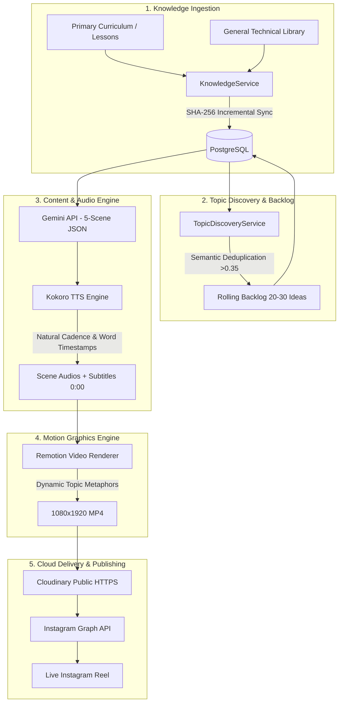

# Autonomous Reel Agent

**AI-Powered Educational Video Generator & Autonomous Instagram Publisher**  
An autonomous end-to-end pipeline that ingests technical knowledge, discovers engaging topics, writes grounded scripts, synthesizes human speech, renders dynamic Remotion motion graphics, and publishes daily Instagram Reels — 100% free and automated.

---

## Architecture Overview



---

## Core Features & Invariants

### 1. Two-Source Knowledge Base Architecture
* **Source A (Primary Course Curriculum):** Ingests lessons directly from course markdown directories (`content.md` + `metadata.json`) with SHA-256 checksum incremental sync. Never duplicates lesson files manually.
* **Source B (General Technical Reference Library):** Ingests verified reference markdown documents (`knowledge-base/`) with official documentation citations and `is_verified: true` validation gates.
* **Provenance Invariant:** The system strictly prevents hallucinations and never claims an interactive course or lab exists unless the topic originates from Source A.

### 2. Multi-Stage Semantic Topic Deduplication
* Automatically maintains a rolling backlog of **20–30 high-potential topics** (target: 25).
* Evaluates topics on curiosity gap, visual animation suitability, and beginner accessibility.
* Rejects duplicate concepts using exact semantic key matching, token overlap checks, and semantic similarity scoring (> 0.35 similarity against previously published, queued, or rejected topics is blocked).
* Automatically replenishes the queue whenever backlog drops below 20.

### 3. Dynamic Topic-Specific Visual Metaphors
* **Zero generic or repetitive middle components across Reels.** Each category renders a purpose-built visual architecture:
  * **Docker & Containers:** **Layer Recipe Stack** in Hook; **Dashed Isolated Workload Sandbox** in Scene 1 (`ISOLATED WORKLOAD • CGROUPS & NAMESPACES` with `▶ RUNNING PROCESS (PID 1)` and private namespaces).
  * **DevOps CI/CD:** **Developer-to-Automation Node Flow** in Hook; **Horizontal 3-Stage Pipeline** in Scene 1 (`CODE` $\to$ `BUILD` $\to$ `TEST`) with horizontal connecting wires and telemetry.
  * **Nginx & Networking:** **Network Flow Topology** in Hook (Client IP $\to$ TCP Bridge $\to$ Upstream Proxy); **Traffic Ingress Conduit** in Scene 1.
  * **Linux Filesystem:** Sliding drawer cards in Hook; authentic **Linux Filesystem Tree Explorer** in Scene 1 (`tree -p /etc`, `├──`, `└──`, Unix permissions `drwxr-xr-x`, and VFS telemetry).
  * **Linux Permissions & Security:** **Octal 755 3-Column Grid** in Hook; **2-Column Split Scope Cards** in Scene 2.
  * **Terminal Demonstrations:** Dark macOS/Linux terminal window with syntax highlighting and live typing.

### 4. Natural Voiceover & Word-Level Subtitles
* Local **Kokoro TTS** synthesizes speech with human-like cadence (`1.0x`–`1.02x`).
* Automatic **`0.35s` natural hold** between speech completion and visual cuts.
* Word-level timestamps ensure animated subtitles start immediately at `0:00` with zero lag or clipping.
* Strict safe area containment (upper 80% / 1536px safe; bottom 20% clear for platform overlays). Zero emojis; Lucide SVG icons only.

### 5. 100% Free Autonomous Cloud Publishing
* **Public Video Delivery:** Rendered MP4s upload automatically to **Cloudinary** for public HTTPS delivery, using <0.5% of the 25 GB free monthly allowance.
* **Meta Graph API:** 3-step Reel Container Flow (`media_type: 'REELS'`, container polling, `media_publish`).
* **Always-On Scheduling:** Runs headlessly via **GitHub Actions** (`.github/workflows/daily-reel.yml`) every day at 14:00 PKT (09:00 UTC) on free 16 GB RAM GitHub runners with free cloud PostgreSQL ([Neon.tech](https://neon.tech)).

---

## Repository Structure

```text
remotion-reel-agent/
├── .github/workflows/       # GitHub Actions automated daily publishing workflow
├── apps/
│   ├── api/                 # Fastify / Express backend API & orchestration
│   │   ├── prisma/          # PostgreSQL Prisma schema and migrations
│   │   └── src/services/    # Gemini, Kokoro TTS, Remotion, Cloudinary, Instagram services
│   └── dashboard/           # Next.js 14 admin dashboard (Topics, Reels, Jobs, Brand)
├── packages/
│   ├── renderer/            # Remotion video compositions & dynamic scenes
│   │   ├── src/scenes/      # HookScene, ContainerDiagram, Pipeline, FolderTree, Comparison, Terminal
│   │   └── src/styles/      # Design system, fonts, and brand theme engine
│   └── schema/              # Zod contracts, validation schemas & scene types
├── knowledge-base/          # Markdown reference library (Docker, CI/CD, Nginx, Linux, K8s)
├── scripts/
│   ├── run-daily-publish.ts # Production headless daily execution runner
│   ├── setup-instagram.ts   # Automated Instagram token exchange & ID discovery
│   ├── sync-knowledge.ts    # Incremental knowledge base synchronizer
│   ├── discover-topics.ts   # Backlog replenishment & topic discovery CLI
│   └── test-7day-suite.ts   # 7-day autonomous simulation & queue reliability test
└── storage/                 # Local media storage and Kokoro TTS ONNX model weights
```

---

## Quickstart

### Prerequisites
* **Node.js:** v22 or v24
* **PostgreSQL:** Local (`localhost:5432`) or cloud ([Neon.tech](https://neon.tech))
* **Redis:** Local (`localhost:6379`) for BullMQ queue (optional in headless mode)
* **API Keys:** Google Gemini API Key (free tier), Meta Graph API credentials, Cloudinary credentials

### 1. Installation
```bash
git clone https://github.com/shaheeeer-dev/remotion-reel-agent.git
cd remotion-reel-agent
npm install
npm run setup:kokoro
```

### 2. Environment Setup
Copy the sample environment file and add your keys:
```bash
cp .env.example .env
```

### 3. Database Migration & Seed
```bash
npm run prisma:generate
npm run prisma:seed
npm run knowledge:sync
```

### 4. Running Locally
```bash
# Start API (port 4000)
npm run dev:api

# Start Admin Dashboard (port 3000)
npm run dev:dashboard

# Start Remotion Studio preview
npm --workspace=@learnops/renderer start
```

---

## CLI Utilities & Commands

| Command | Purpose |
| :--- | :--- |
| `npm run publish:daily` | Executes one complete, autonomous daily Reel generation, render, and publish run. |
| `npm run instagram:setup` | Interactive helper to exchange Meta tokens and auto-discover Instagram Business Account ID. |
| `npm run topics:discover` | Runs topic discovery against the knowledge base and replenishes the backlog to 25 ideas. |
| `npm run knowledge:sync` | Scans curriculum and reference files, updating changed documents via SHA-256 hashes. |
| `npm run test:7day` | Runs the full 7-day autonomous simulation and queue reliability test suite. |
| `npm run build` | Compiles TypeScript across all packages and builds the Next.js production dashboard. |

---

## License
MIT License. Open for educational and autonomous video production systems.
